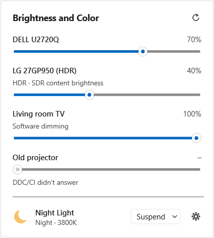
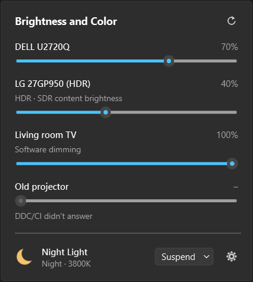
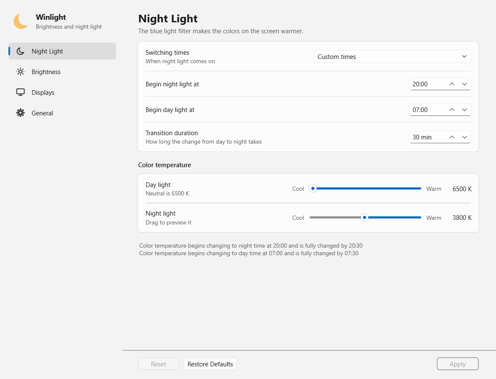

# Winlight

A Windows tray app that manages night light and brightness for several displays from one place. Night light and brightness each run on their own schedule. Night light can be paused on a single display: for any fullscreen app, for apps on a list, or automatically for video, calls, games and color-critical apps. Displays can also be dimmed while the PC is idle, with exceptions for apps that need the screen on.

Brightness is set over DDC/CI for external monitors, through WMI for laptop panels, through Windows' SDR content brightness for HDR displays, and with the gamma ramp for TVs and other displays without a brightness control. Night light uses each display's gamma ramp. Winlight is modelled on KDE Plasma's display settings, written in Python with Qt, and free software under the GPL-3.0.

<p align="center">
  
  &nbsp;
  
</p>

**[Download the latest release](https://github.com/Arnie14/WinLight/releases/latest)** · Windows 11, 64-bit · Beta: the laptop panel, night light, the schedules and the app are tested; external monitors, TVs and HDR displays are being tested now ([status of each feature](docs/features.md)).

## What it manages

| | |
|---|---|
| **Night light** | From 6500 K to as warm as Windows allows, by custom times or sunset to sunrise at your city, with transitions that follow twilight or last as long as you choose |
| **Pausing night light** | On the display that needs true colors only: for any fullscreen app, for apps you list, or automatically for video, calls, games and photo, video and design apps |
| **Brightness** | A slider for every display, whatever its control, each remembered across restarts, sleep and reconnecting |
| **Brightness schedule** | Its own schedule, separate from night light: six presets with gradual transitions, or your own times by clock, sunrise or sunset |
| **Dimming when idle** | After a set time without input, held while an app keeps the screen on, a game runs exclusive fullscreen, or an app you list is in front |
| **Sleep recommendation** | Warm light for the hours before bed, filled in from your bedtime and wake-up time |
| **Displays** | Rename or hide displays, see how each is controlled and why, and save a compatibility report |
| **Command line** | `winlight-cli` for scripts, AutoHotkey, Task Scheduler or a Stream Deck ([reference](docs/command-line.md)) |

Brightness tools for Windows usually manage monitor brightness, and color tools manage color temperature. Winlight manages both, for several displays, with night light paused per display. [Why Winlight?](docs/why-winlight.md) compares it with Windows' own controls and with similar apps, says when one of them may suit you better, and explains how to switch.

<p align="center">
  
</p>

## Getting started

1. Download `Winlight-<version>-setup.exe` from [Releases](https://github.com/Arnie14/WinLight/releases/latest) and run it. It installs for your user only, with no administrator prompt, and starts Winlight at sign-in (a task you can untick during setup). The `…-portable.zip` runs from any folder instead.
2. Builds aren't code-signed yet, so Windows SmartScreen may show "Windows protected your PC": choose **More info**, then **Run anyway**.
3. Click the sun or moon icon in the tray (check the ^ overflow area) for the panel; ⚙ opens Settings.
4. **Turn off Windows Night Light** (Settings > System > Display > Night light) and other color tools: two night lights tint the screen twice. Winlight shows a notice when Windows Night Light is on.
5. External monitors need **DDC/CI** turned on in their own on-screen menu. Most TVs have no DDC/CI; Winlight dims them through their colors instead.

The installer's first page lists what else can clash with Winlight. Settings and logs are kept in `%LOCALAPPDATA%\WinLight`.

## Reporting a problem

Right-click the tray icon and choose **Report a Problem…**. Winlight saves a zip with its logs, settings and what it knows about each display to its Reports folder, copies a summary to the clipboard, and shows the file. Reports are meant to be posted publicly, so your user name, computer name, home folder and email addresses are replaced with placeholders, and your location, custom display names and listed apps are left out. Open an [issue](https://github.com/Arnie14/WinLight/issues), paste the summary and attach the zip. The zip is deleted after 7 days.

If Microsoft Defender flags a build, please [submit it to Microsoft as a false positive](https://www.microsoft.com/wdsi/filesubmission) and open an issue.

## Documentation

- [Features and status](docs/features.md): what each feature does and how far it is tested, and the roadmap
- [Why Winlight?](docs/why-winlight.md): compared with Windows' controls and similar apps, the project's goals, and switching
- [Command line](docs/command-line.md): `winlight-cli` options, exit codes, and equivalents in other tools
- [Windows notes](docs/windows-notes.md): how Winlight uses the Windows APIs, its reliability and safety design, and known limits
- [Testing with the installer](docs/testing-installer.md) and the [full test plan](docs/windows-testing.md)
- [Development](docs/development.md): running from source, tests, the hardware checks, building and releasing, and the repository layout
- [Changelog](CHANGELOG.md)

## Development

```powershell
git clone https://github.com/Arnie14/WinLight.git
cd WinLight
py -3 -m venv .venv
.venv\Scripts\activate
pip install -e ".[dev]"
python main.py
```

Tests run with `pytest` and lint with `ruff check .`; `python tools/hardware_checks.py` checks the backends against the real Windows APIs. Building, releasing and the repository layout are in [docs/development.md](docs/development.md).

## License

Winlight is free software under the **GNU General Public License v3.0**; see [LICENSE](LICENSE). Source files carry an `SPDX-License-Identifier: GPL-3.0-only` header. The Windows app includes Qt and PySide6 (LGPL-3.0), Python and other components under their own licenses, listed with their full texts in `THIRD_PARTY_NOTICES.txt` in the app's folder and under Settings > General > About.

## Acknowledgements

Behavior, wording and some data are based on the open-source work of other projects, used under licenses compatible with the GPL-3.0:

- **[KDE Plasma](https://kde.org/plasma-desktop/)**: the design of the Brightness and Color panel and the Night Light settings page, KWin's Night Light transition behavior and timings, KWin's composition of brightness and color temperature into one transform per display, and the schedule rules from [knighttime](https://invent.kde.org/plasma/knighttime). KWin and PowerDevil are GPL-2.0-or-later; knighttime is LGPL.
- **[f.lux](https://justgetflux.com/)**: the idea of pausing night light for chosen apps and fullscreen.
- **[Monitorian](https://github.com/emoacht/Monitorian)** (MIT) and **[Twinkle Tray](https://github.com/xanderfrangos/twinkle-tray)** (MIT): their users' requests for a command line and its shape; Twinkle Tray's brightness schedule, renaming and hiding displays, and its safer detection after a crash (1.18); Monitorian's power notifications; and how the Windows display, DDC/CI, WMI, SDR white level and gamma APIs are used, one class per kind of brightness control, the order of fallbacks, Twinkle Tray's driver-safe software dimming curve, flyout placement and tray behavior, retry and re-detection timings, and many Windows quirks. No code is copied; the approaches are re-implemented in Python, as described in [docs/windows-notes.md](docs/windows-notes.md).
- **[Redshift](https://github.com/jonls/redshift)** (GPL-3.0) and KWin: the blackbody color table by Ingo Thies (2013) used in [nightlight/core/colortemp.py](nightlight/core/colortemp.py).
- Python libraries: [PySide6](https://doc.qt.io/qtforpython-6/) (LGPL-3.0), [WMI](https://github.com/tjguk/wmi) (MIT) with [pywin32](https://github.com/mhammond/pywin32) (PSF), [astral](https://github.com/sffjunkie/astral) (Apache-2.0), [platformdirs](https://github.com/tox-dev/platformdirs) (MIT), [tzdata](https://github.com/python/tzdata) (Apache-2.0); for Linux development, [monitorcontrol](https://github.com/newAM/monitorcontrol) (MIT) and [jeepney](https://gitlab.com/takluyver/jeepney) (MIT).
